# ScholarFlow MCP

**Unified Academic Research & Reproducible Systematic Literature Review (SLR) MCP Server + Agent Skill Bundle**

[](https://github.com/AkmalRamadhan04/scholarflow-mcp/actions/workflows/ci.yml)
[](https://www.python.org/downloads/)
[](https://modelcontextprotocol.io/)
[](LICENSE)

> **Bahasa Indonesia?** Read [README.id.md](README.id.md).

**ScholarFlow MCP** bridges the gap between prompt-driven AI research assistants and **journal-ready, audit-grade academic reproducibility**. Built with the official Python MCP SDK (`FastMCP`) and bundled with a portable Agent Skill (`skills/scholarflow/SKILL.md`), it gives AI agents (Antigravity, Claude Desktop/Code, Cursor) **14 deterministic tools** that keep your physical PDFs, screening logs, closed-taxonomy coding matrices, blinded human inter-rater reliability worksheets, BibTeX/RIS files, 300 DPI figures, and Word/Markdown manuscripts **100% synchronized**.

---

## Why ScholarFlow MCP?

Most AI academic assistants stop at literature search, abstract screening, or free-form prose drafting—leaving researchers vulnerable to **count drift**, **corrupt PDFs**, **broken Excel dropdowns**, **leaked coder labels**, **malformed RIS author lines**, and **uncited references**.

ScholarFlow solves this by enforcing **7 deterministic reproducibility stages** alongside standard academic workflows:

| Capability | Typical AI Research Skill | ScholarFlow MCP + Skill |
| :--- | :--- | :--- |
| **Protocol & Flow Accounting** | Narrative PRISMA summary | Exact 5-pathway **SPAR-4-SLR** (*Assembling → Arranging → Assessing*) & **PRISMA 2020** arithmetic invariants |
| **Physical PDF Corpus Ops** | Text/metadata only | Non-destructive routing (`1_Core`, `3_Excluded`, `6_Background`, `archive_misfiltered` + CSV manifest) & `PyMuPDF` corruption verification |
| **Full-Text Acquisition** | Basic API fetch | Hybrid legal **OpenAlex OA + `citation_pdf_url`/OJS** fetcher (strict CAPTCHA refusal) + clickable Excel **manual download queue** |
| **Closed-Taxonomy Coding** | Unstructured notes | **ADO–TCM** extraction matrix with closed codebooks & **Excel-safe cell-range DataValidation** (prevents Excel's 255-char corruption bug) + 1-to-1 Markdown reading notes |
| **Human Inter-Rater Reliability** | AI-only dual screening | **100%-blinded standalone Excel export** (zero Coder 1 leakage) with cluster-stratified shared overlap + automated **% Agreement, Cohen's Kappa ($\kappa$), & PABAK** |
| **Manuscript & Figure Sync** | Manual copy-paste | **Single Source of Truth**: generates 300 DPI PNG charts + synchronized `.docx` & `.md` snapshots directly from Excel |
| **Pre-Submission Gate** | Qualitative checklist | **4-Way Deterministic Integrity Audit** (20+ automated cross-checks across PDFs ↔ Search Log ↔ Matrix/Notes ↔ Manuscript/Bib/RIS/Protocol) |

---

## Architecture

```mermaid
flowchart LR
    Agent["AI Agent\n(Antigravity / Claude / Cursor)"]
    Skill["Agent Skill\nskills/scholarflow/SKILL.md"]
    Server["FastMCP Server\nscholarflow-mcp"]

    Agent --> Skill --> Server

    subgraph Pipeline["8 Modular Reproducible Stages (14 Tools)"]
        S0["0. Scaffold\n(EN / ID Presets)"]
        S1["1. Multi-DB Dedup\n& 5-Pathway Flow"]
        S2["2. Legal OA Fetch\n& Clickable Queue"]
        S3["3. Physical Routing\n& 1-to-1 Notes"]
        S4["4. Closed-Taxonomy\nADO-TCM Matrix"]
        S5["5. Blinded Coder 2\n& Kappa / PABAK"]
        S6["6. Verified BibTeX\n& Clean RIS"]
        S7["7. 300 DPI Figures\n& DOCX/MD Sync"]
        S8["8. 4-Way Integrity\nAudit (20+ Checks)"]
    end

    Server --> S0 --> S1 --> S2 --> S3 --> S4 --> S5 --> S6 --> S7 --> S8
```



---

## Quick Installation

### Option 1: Run Directly via `uvx` (Recommended — Zero Manual Clone)

```bash
uvx --from git+https://github.com/AkmalRamadhan04/scholarflow-mcp scholarflow-mcp
```

### Option 2: Install from Source with `uv`

```bash
git clone https://github.com/AkmalRamadhan04/scholarflow-mcp.git
cd scholarflow-mcp
uv sync --extra dev
uv run scholarflow-mcp
```

---

## Client Configuration (MCP + Agent Skill)

### Google Antigravity (`mcp_config.json`)

```json
{
  "mcpServers": {
    "scholarflow": {
      "command": "uvx",
      "args": [
        "--from",
        "git+https://github.com/AkmalRamadhan04/scholarflow-mcp",
        "scholarflow-mcp"
      ]
    }
  }
}
```

To also enable the methodology skill in Antigravity, copy `skills/scholarflow/` into `~/.gemini/config/skills/scholarflow/`.

### Claude Desktop / Claude Code / Cursor

Add the exact same `scholarflow` server block to:
- **Claude Desktop:** `claude_desktop_config.json`
- **Claude Code:** `claude mcp add scholarflow -- uvx --from git+https://github.com/AkmalRamadhan04/scholarflow-mcp scholarflow-mcp`
- **Cursor:** `.cursor/mcp.json`

---

## Complete Tool, Resource & Prompt Reference

### 14 Deterministic MCP Tools

| Stage | Tool Name | Purpose |
| :---: | :--- | :--- |
| **0** | `init_research_project` | Scaffold reproducible workspace (`EN` or `ID` preset), `scholarflow.yaml`, Excel workbooks & protocol DOCX |
| **1** | `ingest_and_deduplicate_exports` | Parse Scopus, OpenAlex, Crossref, SciELO, GS/PoP CSV, `.ris`, & `.bib` across 5 pathways with DOI/title dedup |
| **1** | `reconcile_flow_counts` | Enforce exact 5-pathway SPAR-4-SLR / PRISMA 2020 flow arithmetic equations |
| **2** | `fetch_open_access_pdfs` | Legal OA PDF retriever (OpenAlex + `citation_pdf_url`/OJS) with strict CAPTCHA refusal & PyMuPDF validation |
| **2** | `build_manual_download_queue` | Generate prioritized `Fulltext_Download_Queue` sheet with clickable DOI/URL hyperlinks & standardized filenames |
| **3** | `route_corpus_files` | Non-destructively route files (`core`, `excluded`, `background`, `misfiltered` + CSV manifest), verify PDFs & create 1-to-1 reading notes |
| **4** | `configure_extraction_matrix` | Configure closed taxonomy (`Paradigm_Cluster`, `Method_Code`, ADO–TCM) & Excel-safe cell-range dropdowns |
| **5** | `export_blinded_coder_workbook` | Export a 100%-blinded human co-coder workbook (zero Coder 1 leakage) with cluster-stratified shared overlap |
| **5** | `compute_interrater_reliability` | Compute `% Agreement`, **Cohen's Kappa ($\kappa$)**, **PABAK**, Landis–Koch rating, & itemized disagreements |
| **6** | `verify_and_export_bibliography` | Optional live Crossref/OpenAlex DOI verification + clean `.bib` & `.ris` export (zero `&`-joined RIS `AU` bugs) |
| **7** | `generate_slr_figures` | Build 3 publication-ready **300 DPI** PNG figures directly from `Search_Log.xlsx` & `Extraction_Matrix.xlsx` |
| **7** | `sync_manuscript_snapshot` | Single-Source-of-Truth builder compiling synchronized `.docx` & `.md` manuscript with embedded figures & appendix table |
| **8** | `run_four_way_integrity_audit` | Execute **20+ deterministic 4-way checks** across PDFs, Search Log, Extraction Matrix/Notes, Manuscript, Bib/RIS & Protocol |
| **8** | `get_project_status` | Instant dashboard of pipeline counts, pending items, last audit status, and next recommended tool |

### 3 MCP Resources & 3 Guided Prompts

- **Resources:** `scholarflow://guide/spar4slr`, `scholarflow://guide/integrity-contract`, `scholarflow://templates/reading-note`
- **Prompts:** `start_systematic_review`, `run_screening_and_extraction_cycle`, `pre_submission_integrity_gate`

---

## Development & Verification

```bash
# Lint with Ruff
uv run ruff check src tests

# Run full unit & end-to-end 8-stage synthetic pipeline tests
uv run pytest -v

# Build wheel & source distribution
uv build
```

All tests run on a **100% synthetic demo dataset** (`examples/synthetic_demo/`) — zero private or unpublished manuscript data is included in this repository.

---

## Documentation

- [Architecture & 4-Way Integrity Design](docs/architecture.md)
- [Workflow Comparison: Standard AI Skills vs. ScholarFlow MCP](docs/workflow-comparison.md)
- [Agent Skill Specification](skills/scholarflow/SKILL.md)
- [Dokumentasi Bahasa Indonesia](README.id.md)

---

## Author & License

Created by **Akmal Ramadhan** ([@AkmalRamadhan04](https://github.com/AkmalRamadhan04)).  
Released under the [MIT License](LICENSE).

```bibtex
@software{ramadhan2026scholarflow,
  author  = {Ramadhan, Akmal},
  title   = {ScholarFlow MCP: Unified Academic Research and Reproducible SLR MCP Server},
  year    = {2026},
  url     = {https://github.com/AkmalRamadhan04/scholarflow-mcp},
  version = {0.1.0}
}
```
