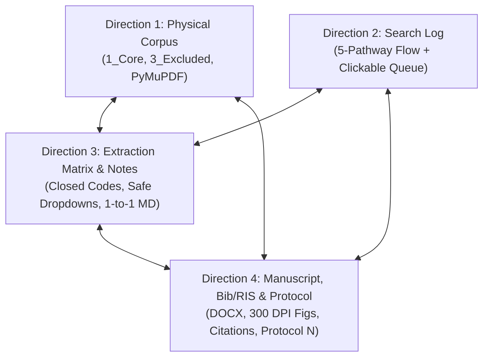

# ScholarFlow MCP Architecture

## Design Philosophy: Separation of Reasoning and Determinism

Large Language Models excel at research scoping, conceptual synthesis, qualitative appraisal, and academic prose—but they are **unreliable at exact counting, file-system consistency, binary Excel XML rules, and cross-artifact synchronization**.

ScholarFlow splits responsibilities cleanly across two layers:

1. **Agent Skill Layer (`skills/scholarflow/SKILL.md`):** Guides methodological choices, human confirmation checkpoints, FINER RQ formulation, and untrusted third-party data boundaries.
2. **Deterministic MCP Server Layer (`src/scholarflow_mcp/`):** Executes every state-mutating, arithmetic, binary-file, and verification operation in pure, tested Python.

## Single Source of Truth & 4-Way Audit Graph

## Key Engineering Safeguards

- **Excel 255-Character DataValidation Guard:** Inline list dropdowns in OOXML (`formula1='"a,b,c"'`) silently corrupt Excel workbooks once the joined string exceeds 255 characters. ScholarFlow exclusively writes cell-range formulas (`=Codebook!$A$2:$A$N`) and audits every workbook to detect any accidental inline overflow.
- **Zero-Leakage Blinded Co-Coding:** `export_blinded_coder_workbook` reads Coder 1's `Paradigm_Cluster` purely in memory to stratify the shared overlap sample across clusters, then emits a clean standalone Excel workbook containing **zero Coder 1 classification columns**.
- **Clean RIS Author Splitting:** Many reference managers choke when multi-author strings containing `&` are dumped into a single `AU  -` line. `bibliography.py` normalizes `;`, `and`, and `&` separators into individual `AU  -` tags, and `audit.py` explicitly fails if any `&` appears in an `AU  -` line.
- **Ethical OA Retrieval Boundary:** `acquisition.py` strictly inspects HTTP responses for CAPTCHA and anti-bot challenge signatures and immediately aborts without attempting circumvention, routing restricted papers to the clickable manual download queue.
